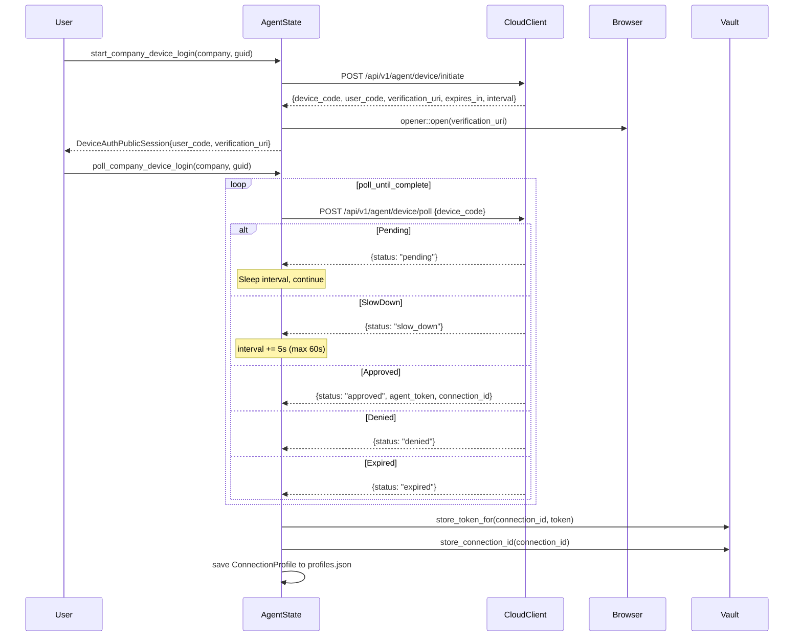
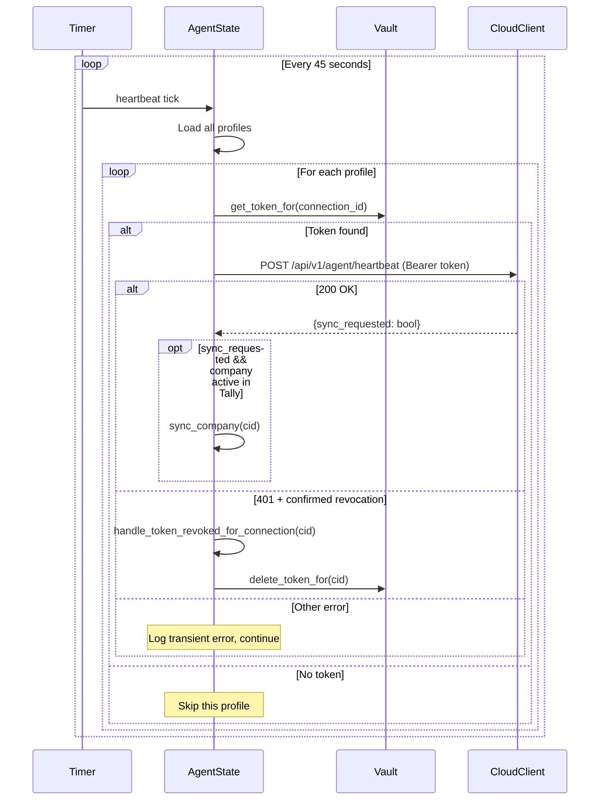
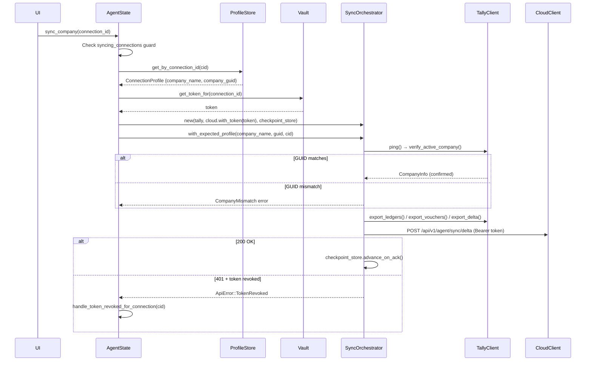
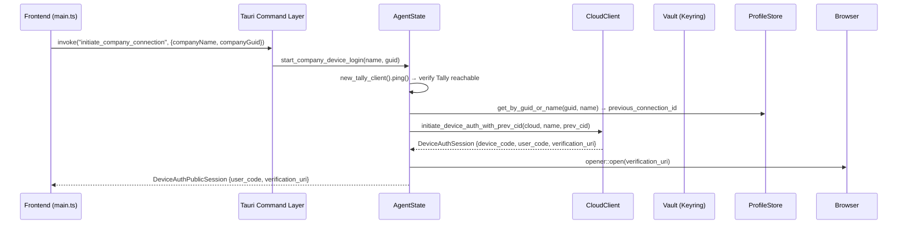
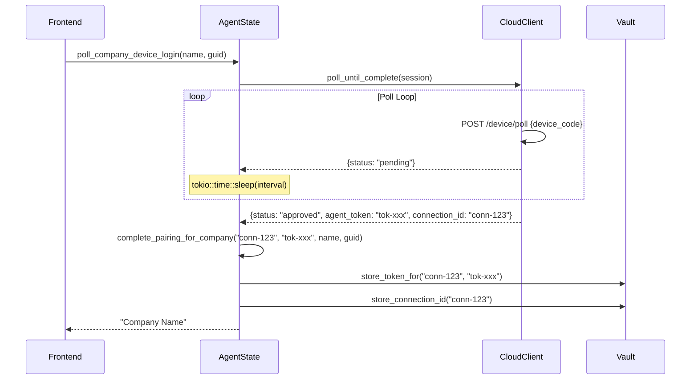
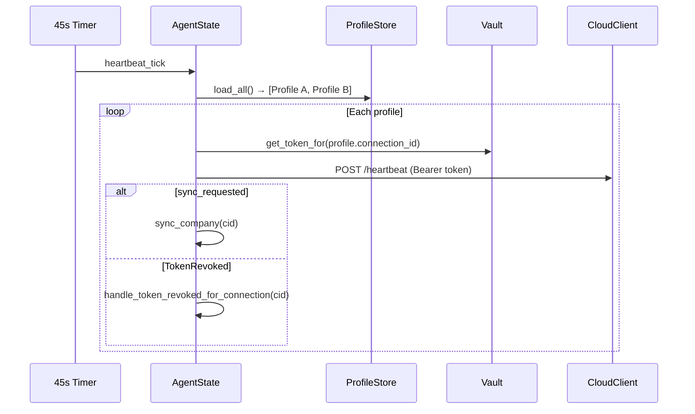
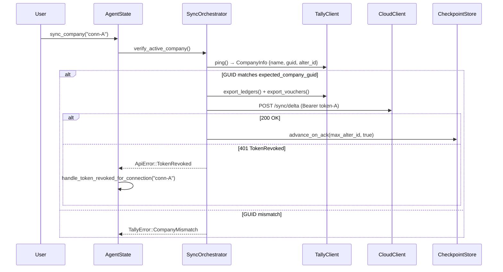
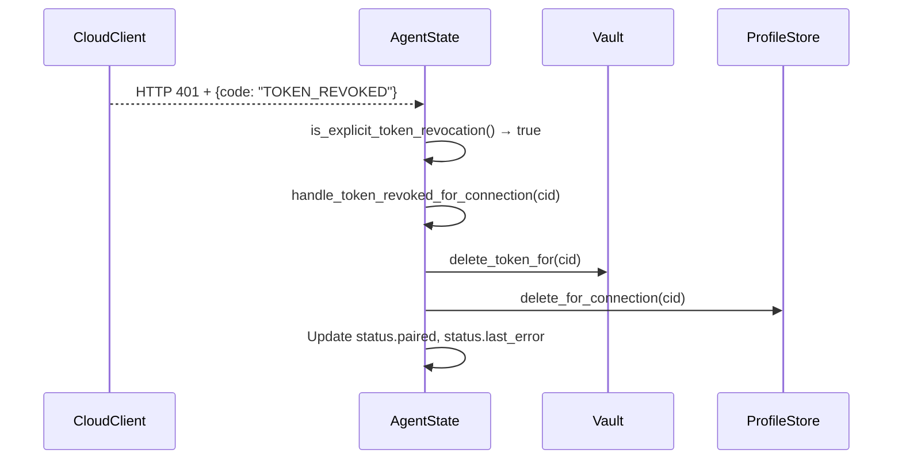
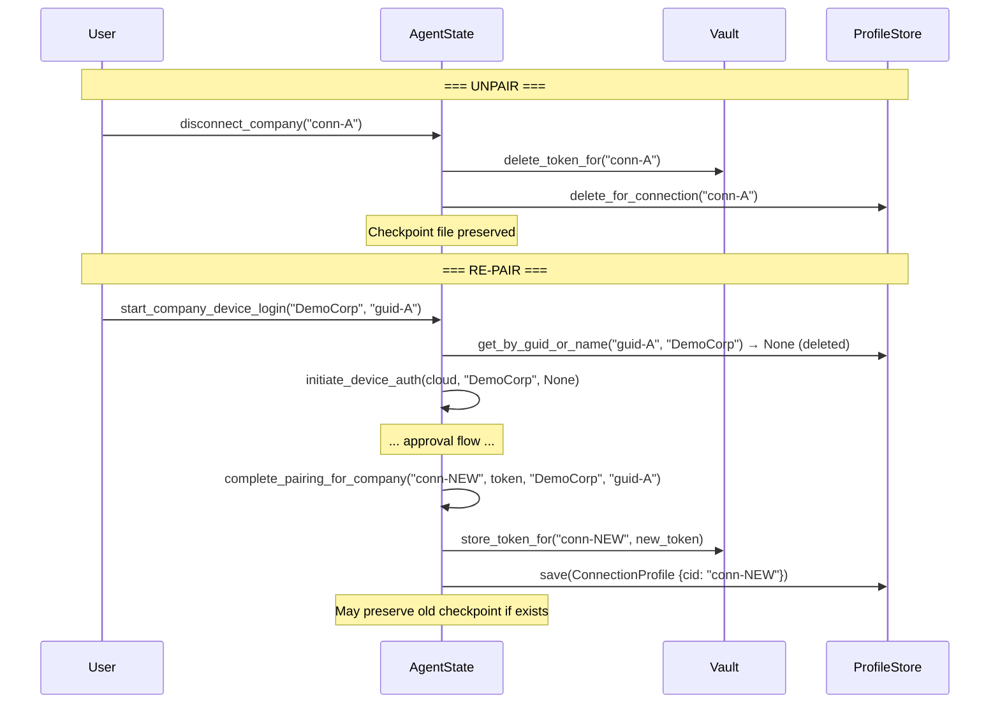
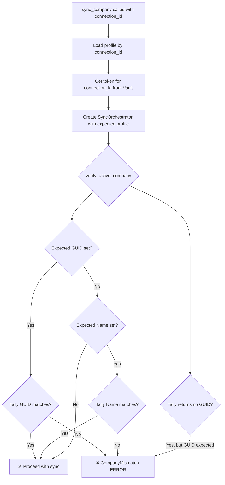

# FinInsight Tally Agent — Production-Readiness Security & Authentication Audit

> **Audit Date**: 2026-09-23  
> **Scope**: `K:\Pratice_Codes\Tally-Connector\tally-agent` (read-only)  
> **Auditor**: Antigravity AI  
> **Status**: **AUDIT ONLY — NO MODIFICATIONS MADE**

---

## A. Executive Summary

The FinInsight Tally Agent is a Tauri-based desktop application that syncs accounting data from local Tally ERP (read-only, Export-only) to a cloud backend via authenticated HTTPS APIs. The agent implements an RFC 8628-style device authorization flow for browser-based login, stores credentials in the OS keyring via the `keyring` crate, and enforces multi-company isolation through per-connection token scoping and GUID-based company verification.

**Key Strengths:**
- ✅ OS-native keyring credential storage (Windows Credential Manager, macOS Keychain, Linux Secret Service)
- ✅ Compile-time enforcement of Export-only Tally operations (no Import variant exists)
- ✅ Comprehensive log redaction (tokens, XML, financial data, GSTIN, PAN)
- ✅ GUID-first company verification with fail-closed behavior
- ✅ Per-connection token isolation via `agent-token:{connection_id}` keyring entries
- ✅ Checkpoint advances only after backend HTTP 200 acknowledgment
- ✅ Atomic file writes for profiles and checkpoints
- ✅ Loopback-only Tally endpoint enforcement
- ✅ Explicit `TokenRevoked` detection with token cleanup
- ✅ Comprehensive test coverage (~50 integration tests, ~30 unit tests)

**Key Concerns:**
- ⚠️ Legacy token fallback path (`Vault::get_token()`) can leak a shared token across connections
- ⚠️ No explicit HTTP request timeout on cloud API calls
- ⚠️ One log statement in `cloud_client.rs` logs raw response body on pairing failure
- ⚠️ No token rotation/refresh mechanism
- ⚠️ No rate limiting on API calls from the agent side

---

## B. API Inventory

All cloud API endpoints are defined in [cloud_client.rs](file:///k:/Pratice_Codes/Tally-Connector/tally-agent/src-tauri/src/cloud_client.rs).

| # | API Endpoint | Method | Purpose | Auth | Token Header | Connection Scope | 401 Behavior | Retry |
|---|---|---|---|---|---|---|---|---|
| 1 | `/api/v1/agent/pair` | POST | Legacy code-based pairing | **None** | N/A | Creates connection | Returns `PairingFailed` error | **No** |
| 2 | `/api/v1/agent/device/initiate` | POST | Start device auth session | **None** | N/A | Creates session | Returns `InvalidResponse` error | **No** |
| 3 | `/api/v1/agent/device/poll` | POST | Poll device auth status | **None** (device_code in body) | N/A | Session-scoped | Returns `InvalidResponse` error | **Yes** — poll loop with backoff |
| 4 | `/api/v1/agent/sync/delta` | POST | Push sync data (initial & delta) | **Bearer** | `Authorization: Bearer <token>` | Per-connection | `TokenRevoked` → clear token | **No** automatic retry |
| 5 | `/api/v1/agent/heartbeat` | POST | Report liveness | **Bearer** | `Authorization: Bearer <token>` | Per-connection | `TokenRevoked` → clear token | **No** automatic retry |

### API Details

#### `/api/v1/agent/pair` ([L267-L299](file:///k:/Pratice_Codes/Tally-Connector/tally-agent/src-tauri/src/cloud_client.rs#L267-L299))
- **Request**: `{ "code": "<UPPERCASED_CODE>" }`
- **Response**: `PairResponse { token, agent_token, connection_id, organization_id, company_name, data }`
- **404**: Treated as `PairingFailed`
- **403**: Treated as `PairingFailed`
- **Timeout**: No explicit timeout (uses reqwest defaults)
- **Offline**: `ApiError::Network`

#### `/api/v1/agent/device/initiate` ([L302-L337](file:///k:/Pratice_Codes/Tally-Connector/tally-agent/src-tauri/src/cloud_client.rs#L302-L337))
- **Request**: `DeviceInitiateRequest { hostname, label, agentLabel, companyName, previousConnectionId }`
- **Response**: `{ device_code, user_code, verification_uri, expires_in, interval }`
- **Timeout**: No explicit timeout

#### `/api/v1/agent/device/poll` ([L340-L371](file:///k:/Pratice_Codes/Tally-Connector/tally-agent/src-tauri/src/cloud_client.rs#L340-L371))
- **Request**: `{ "device_code": "<code>" }`
- **Response**: `{ status, token/agent_token, connection_id }`
- **400**: Treated as valid response (parsed for status)
- **Timeout**: No explicit timeout

#### `/api/v1/agent/sync/delta` ([L374-L453](file:///k:/Pratice_Codes/Tally-Connector/tally-agent/src-tauri/src/cloud_client.rs#L374-L453))
- **Request (initial)**: `SyncBatchPayload { batch_index, total_batches, entity_type, records, alter_id_high }`
- **Request (delta)**: `DeltaSyncPayload { records, alter_id_high }`
- **Auth**: `Authorization: Bearer <token>` via `bearer_auth()`
- **401**: Calls `is_explicit_token_revocation()` → `ApiError::TokenRevoked` if confirmed
- **Non-401 failure**: `ApiError::SyncFailed(status_code)`

#### `/api/v1/agent/heartbeat` ([L457-L497](file:///k:/Pratice_Codes/Tally-Connector/tally-agent/src-tauri/src/cloud_client.rs#L457-L497))
- **Request**: `HeartbeatPayload { tally_reachable, agent_version, last_known_alter_id }`
- **Response**: `HeartbeatResponse { sync_requested }`
- **Auth**: `Authorization: Bearer <token>` via `bearer_auth()`
- **401**: `ApiError::TokenRevoked` if confirmed
- **Non-401 failure**: `ApiError::HeartbeatFailed(status_code)`

### Local Tally API (not cloud)

| # | Target | Method | Purpose | Auth | Timeout |
|---|---|---|---|---|---|
| T1 | `http://127.0.0.1:{port}` | POST | Ping / Company Info | **None** (loopback only) | 5s |
| T2 | `http://127.0.0.1:{port}` | POST | Discover Companies | **None** | 8s |
| T3 | `http://127.0.0.1:{port}` | POST | Export Ledgers | **None** | 120s |
| T4 | `http://127.0.0.1:{port}` | POST | Export Vouchers | **None** | 120s |
| T5 | `http://127.0.0.1:{port}` | POST | Export Delta | **None** | 120s |

All Tally connections are enforced to loopback (`127.0.0.1`, `localhost`, `::1`) by [`validate_loopback()`](file:///k:/Pratice_Codes/Tally-Connector/tally-agent/src-tauri/src/tally_client.rs#L48-L53).

---

## C. Device Auth Lifecycle (RFC 8628)

### Implementation: [`device_auth.rs`](file:///k:/Pratice_Codes/Tally-Connector/tally-agent/src-tauri/src/device_auth.rs)



### Lifecycle Trace

| Step | Function | File | Line |
|---|---|---|---|
| 1. User clicks "Connect" | `start_company_device_login()` | [lib.rs](file:///k:/Pratice_Codes/Tally-Connector/tally-agent/src-tauri/src/lib.rs#L436-L485) | L436 |
| 2. Verify Tally reachable | `tally.ping()` | [lib.rs](file:///k:/Pratice_Codes/Tally-Connector/tally-agent/src-tauri/src/lib.rs#L443) | L443 |
| 3. Check existing profile | `profile_store.get_by_guid_or_name()` | [lib.rs](file:///k:/Pratice_Codes/Tally-Connector/tally-agent/src-tauri/src/lib.rs#L447-L461) | L447 |
| 4. POST device/initiate | `initiate_device_auth_with_prev_cid()` | [device_auth.rs](file:///k:/Pratice_Codes/Tally-Connector/tally-agent/src-tauri/src/device_auth.rs#L234-L294) | L234 |
| 5. Open browser | `opener::open()` | [lib.rs](file:///k:/Pratice_Codes/Tally-Connector/tally-agent/src-tauri/src/lib.rs#L471) | L471 |
| 6. Store session in memory | `active_device_session` | [lib.rs](file:///k:/Pratice_Codes/Tally-Connector/tally-agent/src-tauri/src/lib.rs#L480) | L480 |
| 7. Poll loop | `poll_until_complete()` | [device_auth.rs](file:///k:/Pratice_Codes/Tally-Connector/tally-agent/src-tauri/src/device_auth.rs#L376-L466) | L376 |
| 8. Approval → complete pairing | `complete_pairing_for_company()` | [lib.rs](file:///k:/Pratice_Codes/Tally-Connector/tally-agent/src-tauri/src/lib.rs#L536-L641) | L536 |
| 9. Store token in Vault | `Vault::store_token_for()` | [lib.rs](file:///k:/Pratice_Codes/Tally-Connector/tally-agent/src-tauri/src/lib.rs#L588) | L588 |
| 10. Save profile to disk | `profile_store.save()` | [lib.rs](file:///k:/Pratice_Codes/Tally-Connector/tally-agent/src-tauri/src/lib.rs#L584) | L584 |

### Edge Cases Verified from Code

| Scenario | Code Behavior | Evidence |
|---|---|---|
| User never approves | `poll_until_complete()` loops until `session.expires_at` → returns `Expired` | [device_auth.rs:L392-L398](file:///k:/Pratice_Codes/Tally-Connector/tally-agent/src-tauri/src/device_auth.rs#L392-L398) |
| User rejects | Poll returns `Denied` → returns `DeviceAuthDenied` error | [device_auth.rs:L448-L451](file:///k:/Pratice_Codes/Tally-Connector/tally-agent/src-tauri/src/device_auth.rs#L448-L451) |
| Device code expires (server-side) | Poll returns `status: "expired"` → returns `Expired` | [device_auth.rs:L325](file:///k:/Pratice_Codes/Tally-Connector/tally-agent/src-tauri/src/device_auth.rs#L325) |
| Device code expires (local) | `Instant::now() >= session.expires_at` → returns `Expired` | [device_auth.rs:L392](file:///k:/Pratice_Codes/Tally-Connector/tally-agent/src-tauri/src/device_auth.rs#L392) |
| Backend unavailable during poll | `ApiError::Network` propagated → poll loop terminates with error | [device_auth.rs:L456-L463](file:///k:/Pratice_Codes/Tally-Connector/tally-agent/src-tauri/src/device_auth.rs#L456-L463) |
| SlowDown response | Interval increases by 5s, capped at 60s | [device_auth.rs:L423-L433](file:///k:/Pratice_Codes/Tally-Connector/tally-agent/src-tauri/src/device_auth.rs#L423-L433) |
| Pairing succeeds but token storage fails | `Vault::store_token_for()` returns `VaultError` → propagated to caller via `AgentError::Vault` | [lib.rs:L588](file:///k:/Pratice_Codes/Tally-Connector/tally-agent/src-tauri/src/lib.rs#L588) |
| Already consumed code | Returns `Approved` with empty token, preserves existing token | [device_auth.rs:L332-L345](file:///k:/Pratice_Codes/Tally-Connector/tally-agent/src-tauri/src/device_auth.rs#L332-L345) |

### Default Expiry

- `expires_in` defaults to **900s** (15 minutes) if not returned by server ([device_auth.rs:L131](file:///k:/Pratice_Codes/Tally-Connector/tally-agent/src-tauri/src/device_auth.rs#L131))
- `poll_interval` defaults to **5s**, minimum **1s** ([device_auth.rs:L277](file:///k:/Pratice_Codes/Tally-Connector/tally-agent/src-tauri/src/device_auth.rs#L277))
- Max poll interval: **60s** ([device_auth.rs:L371](file:///k:/Pratice_Codes/Tally-Connector/tally-agent/src-tauri/src/device_auth.rs#L371))

---

## D. Connection Token Lifecycle

### Token Creation
- Generated by the **cloud backend** — NOT by the agent
- Returned in `DevicePollResponse.agent_token` or `PairResponse.token`
- Agent receives it after browser approval

### Token Storage
```
OS Keyring (Windows Credential Manager / macOS Keychain / Linux Secret Service)
├── Service: "com.fininsight.tally-agent"
├── Account: "agent-token:{connection_id}"    ← Per-connection token (modern)
├── Account: "agent-token"                     ← Legacy shared token (fallback)
└── Account: "connection-id"                   ← Active connection ID
```

### Token Retrieval Chain

From [cloud_client.rs:L256-L264](file:///k:/Pratice_Codes/Tally-Connector/tally-agent/src-tauri/src/cloud_client.rs#L256-L264):
```
1. CloudClient.bearer_token (in-memory override)
2. → Vault::get_token() (legacy keyring entry "agent-token")
```

From [lib.rs:L695-L697](file:///k:/Pratice_Codes/Tally-Connector/tally-agent/src-tauri/src/lib.rs#L695-L697) (`do_sync_company`):
```
1. Vault::get_token_for(connection_id)  ← connection-scoped
2. → Vault::get_token()                 ← legacy fallback
```

From [lib.rs:L867](file:///k:/Pratice_Codes/Tally-Connector/tally-agent/src-tauri/src/lib.rs#L867) (heartbeat loop):
```
1. Vault::get_token_for(cid)  ← connection-scoped
2. → Vault::get_token()       ← legacy fallback
```

### Token Format
- **Opaque string** — agent does not parse, validate, or inspect the token
- No JWT decoding, no local expiry check
- Token entropy/generation is entirely server-side (NOT VERIFIED from agent code)

### Token Lifecycle Events

| Event | Code Path | Vault Action |
|---|---|---|
| Token created (pairing) | `complete_pairing_for_company()` | `Vault::store_token_for(cid, token)` |
| Token used (sync) | `do_sync_company()` | `Vault::get_token_for(cid)` |
| Token used (heartbeat) | `spawn_heartbeat_loop()` | `Vault::get_token_for(cid)` |
| Token revoked (sync 401) | `handle_token_revoked_for_connection()` | `Vault::delete_token_for(cid)` |
| Token revoked (heartbeat 401) | `handle_token_revoked_for_connection()` | `Vault::delete_token_for(cid)` |
| Disconnect company | `disconnect_company()` | `Vault::delete_token_for(cid)` |
| Disconnect all | `disconnect()` | `Vault::delete_token()` + per-connection |
| Re-pair same company | `complete_pairing_for_company()` | Delete old token, store new |

---

## E. Local Credential Storage

### Storage Mechanism: [vault.rs](file:///k:/Pratice_Codes/Tally-Connector/tally-agent/src-tauri/src/vault.rs)

| Aspect | Detail |
|---|---|
| **Backend** | `keyring` crate v3 with `windows-native`, `apple-native`, `sync-secret-service` features |
| **Windows** | Windows Credential Manager (DPAPI-encrypted) |
| **macOS** | macOS Keychain |
| **Linux** | Secret Service (GNOME Keyring / KDE Wallet) |
| **Service name** | `com.fininsight.tally-agent` |
| **Encryption** | OS-managed (DPAPI on Windows, Keychain on macOS) |
| **Key storage** | OS-managed (user session) |
| **Scope** | Current user — not machine-wide |
| **File-based storage** | **NO** — no plaintext files for tokens |
| **Environment variables** | `FININSIGHT_API_BASE` (non-secret), `TALLY_PORT` (non-secret) — no token env vars |
| **In-memory** | `CloudClient.bearer_token: Option<String>` — cleared on struct drop |
| **Registry** | **NO** — not used |

### Keyring Entries

| Account Key | Content | Created | Deleted |
|---|---|---|---|
| `agent-token:{connection_id}` | Connection-specific agent token | `complete_pairing_for_company()` | `disconnect_company()`, `handle_token_revoked_for_connection()` |
| `agent-token` | Legacy shared token | `Vault::store_token()` | `disconnect()`, `handle_token_revoked()` |
| `connection-id` | Last active connection ID | `complete_pairing_for_company()` | `disconnect()`, `handle_token_revoked_for_connection()` |

### File-Based Persistence (Non-Secret)

| File | Location | Content | Security |
|---|---|---|---|
| `profiles.json` | `%LOCALAPPDATA%\FinInsight\TallyAgent\` | Connection profiles (connection_id, company_name, company_guid, paired_at) | No tokens, atomic writes |
| `checkpoint_{cid}.json` | `%LOCALAPPDATA%\FinInsight\TallyAgent\checkpoints\` | Sync watermark (alter_id, backfill_complete) | No tokens, atomic writes |
| `tally-agent.log` | `%LOCALAPPDATA%\FinInsight\TallyAgent\logs\` | Redacted logs | **See Logging Audit below** |

---

## F. Heartbeat Lifecycle

### Implementation: [`spawn_heartbeat_loop()`](file:///k:/Pratice_Codes/Tally-Connector/tally-agent/src-tauri/src/lib.rs#L846-L926)



| Aspect | Detail |
|---|---|
| **Frequency** | Every 45s (`HEARTBEAT_INTERVAL_SECS`) |
| **Discovery frequency** | Every 45s (`DISCOVERY_INTERVAL_SECS`) |
| **Token used** | Per-connection via `Vault::get_token_for(cid)` with legacy fallback |
| **Connection ID** | From `profile.connection_id` |
| **GUID validation** | Matches profile GUID against active Tally company |
| **401 behavior** | Calls `handle_token_revoked_for_connection()` — deletes token, profile, resets status |
| **Retry** | **No** — transient errors are silently logged, next heartbeat tick retries |
| **Backoff** | **No** — fixed 45s interval |
| **Offline behavior** | `ApiError::Network` logged at debug level, continues to next profile |

---

## G. Sync Authentication

### Implementation: [`do_sync_company()`](file:///k:/Pratice_Codes/Tally-Connector/tally-agent/src-tauri/src/lib.rs#L691-L716)



### Company Verification: [`verify_active_company()`](file:///k:/Pratice_Codes/Tally-Connector/tally-agent/src-tauri/src/sync.rs#L142-L202)

| Condition | Behavior | Fail Mode |
|---|---|---|
| Expected GUID set, Tally GUID matches | ✅ Sync proceeds | — |
| Expected GUID set, Tally GUID differs | ❌ `CompanyMismatch` error | **Fail closed** |
| Expected GUID set, Tally returns no GUID | ❌ `CompanyMismatch` error | **Fail closed** |
| No expected GUID, name matches | ✅ Sync proceeds | — |
| No expected GUID, name differs | ❌ `CompanyMismatch` error | **Fail closed** |
| No expected GUID, no expected name | ✅ Sync proceeds (unscoped) | ⚠️ Only for unpaired state |

### Checkpoint Safety

- **Checkpoint advances ONLY after backend HTTP 200**: [sync.rs:L323-L324](file:///k:/Pratice_Codes/Tally-Connector/tally-agent/src-tauri/src/sync.rs#L323-L324) (backfill), [sync.rs:L424](file:///k:/Pratice_Codes/Tally-Connector/tally-agent/src-tauri/src/sync.rs#L424) (delta)
- **Failed push → checkpoint stays at previous value**
- **Empty extraction (0 ledgers, 0 vouchers) → backfill NOT marked complete**: [sync.rs:L235-L244](file:///k:/Pratice_Codes/Tally-Connector/tally-agent/src-tauri/src/sync.rs#L235-L244)

---

## H. Multi-Company Isolation

> [!IMPORTANT]
> This is the highest-priority security audit area.

### Architecture

The agent supports multiple Tally companies via per-connection isolation:

```
profiles.json
├── ConnectionProfile { connection_id: "conn-A", company_guid: "guid-A", company_name: "DemoCorp" }
├── ConnectionProfile { connection_id: "conn-B", company_guid: "guid-B", company_name: "ProfitCorp" }
└── ConnectionProfile { connection_id: "conn-C", company_guid: "guid-C", company_name: "ThunderClaps" }

OS Keyring:
├── "agent-token:conn-A" → token-A
├── "agent-token:conn-B" → token-B
└── "agent-token:conn-C" → token-C

Checkpoint Files:
├── checkpoints/checkpoint_conn-A.json
├── checkpoints/checkpoint_conn-B.json
└── checkpoints/checkpoint_conn-C.json
```

### Isolation Verification

| Check | Status | Evidence |
|---|---|---|
| Token per connection | ✅ | `Vault::store_token_for(connection_id, token)` with `agent-token:{cid}` key ([vault.rs:L16-L17](file:///k:/Pratice_Codes/Tally-Connector/tally-agent/src-tauri/src/vault.rs#L16-L17)) |
| Checkpoint per connection | ✅ | `CheckpointStore::for_connection_in_dir()` creates `checkpoint_{cid}.json` ([checkpoint.rs:L239-L248](file:///k:/Pratice_Codes/Tally-Connector/tally-agent/src-tauri/src/checkpoint.rs#L239-L248)) |
| Profile lookup by GUID (strict) | ✅ | `get_by_guid_or_name()` uses GUID-only lookup when GUID present ([checkpoint.rs:L117-L122](file:///k:/Pratice_Codes/Tally-Connector/tally-agent/src-tauri/src/checkpoint.rs#L117-L122)) |
| Ambiguous name lookup rejected | ✅ | Multiple profiles with same name + no GUID → error ([checkpoint.rs:L135-L145](file:///k:/Pratice_Codes/Tally-Connector/tally-agent/src-tauri/src/checkpoint.rs#L135-L145)) |
| Company GUID verified before sync | ✅ | `verify_active_company()` with fail-closed on mismatch ([sync.rs:L142-L202](file:///k:/Pratice_Codes/Tally-Connector/tally-agent/src-tauri/src/sync.rs#L142-L202)) |
| Missing GUID → fail closed | ✅ | When expected GUID exists but Tally returns none ([sync.rs:L169-L184](file:///k:/Pratice_Codes/Tally-Connector/tally-agent/src-tauri/src/sync.rs#L169-L184)) |
| Concurrent sync guard | ✅ | `syncing_connections` HashMap prevents parallel syncs per connection ([lib.rs:L651-L657](file:///k:/Pratice_Codes/Tally-Connector/tally-agent/src-tauri/src/lib.rs#L651-L657)) |
| Heartbeat per-connection | ✅ | Loop iterates over profiles, uses per-connection token ([lib.rs:L865-L921](file:///k:/Pratice_Codes/Tally-Connector/tally-agent/src-tauri/src/lib.rs#L865-L921)) |

### ⚠️ Legacy Token Fallback — FINDING

> [!WARNING]
> **Multiple code paths fall back to `Vault::get_token()` (legacy shared token) when `Vault::get_token_for(connection_id)` fails.** This means if a per-connection token is missing but a legacy token exists, a sync could use the wrong connection's token.

**Locations:**
1. [`do_sync_company()`](file:///k:/Pratice_Codes/Tally-Connector/tally-agent/src-tauri/src/lib.rs#L695-L696): `Vault::get_token_for(connection_id).or_else(|_| Vault::get_token())`
2. [`spawn_heartbeat_loop()`](file:///k:/Pratice_Codes/Tally-Connector/tally-agent/src-tauri/src/lib.rs#L867): `Vault::get_token_for(cid).or_else(|_| Vault::get_token())`
3. [`bearer_token()`](file:///k:/Pratice_Codes/Tally-Connector/tally-agent/src-tauri/src/cloud_client.rs#L256-L264): Falls back to `Vault::get_token()`
4. [`AgentState::with_options()`](file:///k:/Pratice_Codes/Tally-Connector/tally-agent/src-tauri/src/lib.rs#L149-L153): `Vault::get_token_for(cid).or_else(|_| Vault::get_token())`

**Risk**: In a multi-company scenario, if Company A's per-connection token is deleted (e.g., revoked) but the legacy shared token still exists from a prior session, Company A's heartbeat or sync might authenticate using a token that belongs to a different connection. The **backend** should still enforce authorization, but the agent is making an authentication request that could be scoped to the wrong connection.

**Mitigating factor**: The backend's bearer token is tied to a specific `connection_id` on the server side, so a cross-connection token would likely be rejected with 401. However, the agent doesn't verify this mapping locally.

---

## I. 401/403 Failure Handling

### Token Revocation Detection: [`is_explicit_token_revocation()`](file:///k:/Pratice_Codes/Tally-Connector/tally-agent/src-tauri/src/cloud_client.rs#L157-L215)

This function distinguishes between transient 401s (proxy/CDN errors) and genuine token revocations:

| Condition | Treated as Revocation? |
|---|---|
| 401 + empty body | ✅ Yes |
| 401 + HTML/XML body (proxy error) | ❌ No |
| 401 + JSON with code `UNAUTHORIZED`, `TOKEN_REVOKED`, `TOKEN_EXPIRED`, `INVALID_TOKEN`, `CONNECTION_REVOKED` | ✅ Yes |
| 401 + JSON with message containing "invalid", "revoked", "expired", "unauthorized" | ✅ Yes |
| 401 + non-JSON body | ✅ Yes |
| Non-401 status | ❌ No |

### Failure Behavior Matrix

| Failure | Agent Behavior | Retry | Token Cleared | Re-pair Required |
|---|---|---|---|---|
| **401 (confirmed revocation)** | `ApiError::TokenRevoked` → `handle_token_revoked_for_connection()` | ❌ No | ✅ Yes + profile deleted | ✅ Yes |
| **401 (transient/proxy)** | `ApiError::SyncFailed(401)` or `HeartbeatFailed(401)` | ❌ No (next interval) | ❌ No | ❌ No |
| **403** | `ApiError::SyncFailed(403)` or `HeartbeatFailed(403)` | ❌ No | ❌ No | ❌ No |
| **404** | `ApiError::SyncFailed(404)` or `HeartbeatFailed(404)` | ❌ No | ❌ No | ❌ No |
| **5xx** | `ApiError::SyncFailed(5xx)` | ❌ No auto-retry (next heartbeat) | ❌ No | ❌ No |
| **Network failure** | `ApiError::Network` | ❌ No auto-retry (next heartbeat) | ❌ No | ❌ No |
| **Tally unreachable** | `TallyError::ConnectionRefused` | ❌ No auto-retry (next discovery) | ❌ No | ❌ No |
| **Tally timeout** | `TallyError::Timeout` | ❌ No | ❌ No | ❌ No |
| **Company GUID mismatch** | `TallyError::CompanyMismatch` | ❌ No | ❌ No | ❌ No |

---

## J. Retry / Recovery

### Retry Behavior Summary

| Operation | Automatic Retry | Manual Retry | Retry Mechanism |
|---|---|---|---|
| Device auth polling | ✅ Yes — poll loop | N/A | `poll_until_complete()` with backoff |
| Heartbeat | ✅ Yes — 45s timer | N/A | `spawn_heartbeat_loop()` |
| Discovery | ✅ Yes — 45s timer | Refresh button | `discover_and_merge_companies()` |
| Sync (backend failure) | ❌ No auto-retry | Sync Now button | User must click |
| Sync (Tally error) | ❌ No auto-retry | Sync Now button | User must click |
| Sync (TokenRevoked) | ❌ No — clears state | Re-pair required | Device auth flow |

### Resilience Analysis

| Risk | Status | Evidence |
|---|---|---|
| Infinite retry loops | ✅ **Not possible** — sync has no auto-retry; device auth bounded by expiry; heartbeat is periodic | |
| Duplicate sync from retry | ✅ **Not possible** — checkpoint only advances on 200 ACK; re-sync from same alter_id is idempotent | Tested: `test_repeated_sync_does_not_duplicate_records` |
| Token reuse after revocation | ✅ **Handled** — `TokenRevoked` clears token immediately | Tested: `test_token_revocation_on_sync_clears_token_and_resets_status` |
| Excessive API traffic | ⚠️ **Possible** — heartbeat sends to ALL connections every 45s with no rate limiting | |

---

## K. Unpair / Re-pair

### Unpair (Disconnect Company)

[`disconnect_company()`](file:///k:/Pratice_Codes/Tally-Connector/tally-agent/src-tauri/src/lib.rs#L718-L727):

```
1. Vault::delete_token_for(connection_id)   ← Delete from OS keyring
2. profile_store.delete_for_connection(cid)  ← Remove from profiles.json
3. Clear per_company_errors for this cid
4. Refresh discovery
```

> [!NOTE]
> **Checkpoint file is NOT deleted on disconnect.** This is intentional — allows re-pairing the same company without re-downloading all data. Verified by test `test_disconnect_preserves_checkpoint_file`.

### Disconnect All

[`disconnect()`](file:///k:/Pratice_Codes/Tally-Connector/tally-agent/src-tauri/src/lib.rs#L829-L838):

```
1. For each profile: disconnect_company(cid)
2. Vault::delete_token()           ← Legacy shared token
3. Vault::delete_connection_id()   ← Legacy connection ID
4. profile_store.delete()          ← Delete profiles.json entirely
```

### Re-pair

[`start_company_device_login()`](file:///k:/Pratice_Codes/Tally-Connector/tally-agent/src-tauri/src/lib.rs#L436-L485):

```
1. Check existing profile for this company (by GUID/name)
2. Extract previous_connection_id if exists
3. Send previousConnectionId to device/initiate
4. After approval → complete_pairing_for_company():
   a. If old profile exists with different connection_id:
      - Delete old profile
      - Delete old token from vault
   b. Store new profile
   c. Store new token
   d. Preserve checkpoint if applicable
```

### Old Credential Validity After Events

| Event | Old Token Valid? | Verification |
|---|---|---|
| Unpair (disconnect) | **Agent-side**: Deleted from keyring. **Backend-side**: NOT VERIFIED — token may still be valid on server | ⚠️ Agent does NOT call a backend revocation API |
| Re-pair | Old token deleted locally if new connection_id differs; backend may or may not revoke | ⚠️ No explicit backend revocation |
| Connection deleted | Token deleted locally | Backend behavior NOT VERIFIED |

---

## L. Test Coverage

### Existing Tests (from source code analysis)

| Area | Test Count | Key Tests |
|---|---|---|
| **Device pairing (initiate)** | 2 | `test_initiate_device_auth_success`, `test_device_initiate_request_payload_shape` |
| **Device polling** | 7 | `test_poll_pending_to_approved`, `test_poll_pending_to_denied`, `test_poll_pending_to_expired`, `test_poll_local_session_expiry_ceiling`, `test_poll_slowdown_backs_off_interval`, `test_poll_consumed_request_without_new_token_returns_approved`, `test_poll_immediately_approved_on_first_attempt` |
| **E2E device auth** | 4 | `test_device_auth_pending_then_approved_e2e_flow`, `test_device_auth_polling_immediately_after_approval_e2e`, `test_device_auth_denied_stops_polling_and_no_token`, `test_device_auth_expired_stops_polling` |
| **Token storage** | 3 | `test_device_auth_approved_stores_token_via_shared_path`, `test_token_stored_and_retrieved_under_same_connection_id`, `token_roundtrip` |
| **Token deletion** | 2 | `test_disconnect_clears_token_and_connection_id`, `test_token_revocation_on_sync_clears_token_and_resets_status` |
| **401 handling** | 3 | `test_token_revocation_on_sync_clears_token_and_resets_status`, `test_token_revocation_on_heartbeat`, `test_backend_401_explicit_revocation_vs_transient_failure` |
| **Re-pair** | 2 | `test_connection_id_stored_and_survives_token_revocation_for_re_pairing`, `test_re_pairing_replaces_old_profile_and_cleans_up_obsolete_token` |
| **Disconnect** | 2 | `test_disconnect_clears_token_and_connection_id`, `test_disconnect_preserves_checkpoint_file` |
| **Multi-company isolation** | 6 | `test_multi_company_sync_isolation_company_a_vs_company_b`, `test_democorp_data_can_never_be_pushed_through_thunderclaps_connection`, `test_multicompany_democorp_profitcorp_thunderclaps_full_lifecycle`, `test_multicompany_token_isolation_democorp_and_profitcorp`, `test_inactive_company_can_be_paired_while_another_company_active`, `test_crash_during_company_a_sync_leaves_company_b_state_untouched` |
| **GUID mismatch** | 2 | `test_company_guid_mismatch_fails_closed`, `test_agent_restart_loads_profile_and_blocks_wrong_guid` |
| **Checkpoint safety** | 6 | `backend_non_200_leaves_checkpoint_unchanged`, `backend_200_advances_checkpoint`, `test_checkpoint_does_not_advance_on_failed_push`, `test_crash_after_push_before_checkpoint_does_not_corrupt_state`, `test_initial_backfill_with_zero_records_does_not_advance_checkpoint` |
| **Retry** | 3 | `retry_after_failure_sync_orchestrator`, `test_crash_and_retry_idempotent_recovery`, `test_retry_after_success_does_not_duplicate_records` |
| **Tally offline** | 3 | `test_tally_offline_preserves_connected_state_and_recovers_cleanly`, `test_tally_offline_preserves_profile_token_and_checkpoint`, `test_start_device_login_fails_when_tally_unreachable` |
| **Export-only enforcement** | 3 | `request_builder_has_no_import_variant`, `all_envelopes_contain_export_request_type`, `client_only_builds_export_envelopes` |
| **Redaction** | 4 | `redacts_token_shaped_string`, `redacts_xml_body`, `redacts_balance_and_names`, `redacts_gstin_and_pan` |
| **Log rotation** | 2 | `test_logger_writes_to_file`, `test_logger_rotation_preserves_backups` |
| **Data quality** | 2 | `test_data_quality_voucher_checks`, `test_data_quality_ledger_checks` |
| **Restart persistence** | 2 | `test_restart_preserves_multiple_company_profiles_and_tokens`, `test_restart_persistence_loads_profiles_and_retrieves_vault_tokens` |

### Missing Tests

| Missing Test | Priority | Reason |
|---|---|---|
| 403 response handling | MEDIUM | No test verifies agent behavior on 403 |
| Backend 429 (rate limit) | MEDIUM | No rate-limit handling or testing |
| Concurrent sync attempts (race condition) | MEDIUM | `syncing_connections` guard tested implicitly but no explicit race test |
| `is_explicit_token_revocation()` with all code/message permutations | LOW | Only `test_backend_401_explicit_revocation_vs_transient_failure` covers this |
| Legacy token fallback cross-contamination | HIGH | No test verifies that legacy `Vault::get_token()` doesn't leak across connections |
| Token storage failure during pairing (VaultError on set_password) | MEDIUM | No test simulates keyring write failure |
| `previousConnectionId` sent correctly on re-pair | LOW | Partially tested via initiate request payload shape test |
| Cloud API timeout behavior | HIGH | No explicit timeout tests |
| Log redaction completeness for connection_id in error messages | LOW | connection_id appears in log messages unredacted (non-secret but worth noting) |

---

## M. Token Lifetime Matrix

| Credential | Created | Lifetime | Storage | Refresh | Revocation | Deletion |
|---|---|---|---|---|---|---|
| **Device Code** | `POST /device/initiate` | Default 900s (server-controlled) | In-memory (`DeviceAuthSession`) | None | Expires automatically | Dropped when session ends |
| **User Code** | `POST /device/initiate` | Same as device code | In-memory + displayed to user | None | Expires with device code | Dropped when session ends |
| **Device Auth Session** | `initiate_device_auth()` | `Instant::now() + expires_in` | In-memory (`active_device_session: Mutex`) | None | `cancel_device_login()` clears | Cleared on approval/denial/expiry |
| **Connection Token** | `POST /device/poll` (approved) | **NOT VERIFIED** — server-controlled | OS Keyring (`agent-token:{cid}`) | **None — no refresh mechanism** | Server returns 401 with revocation codes | `Vault::delete_token_for(cid)` |
| **Legacy Token** | `POST /agent/pair` (legacy flow) | **NOT VERIFIED** | OS Keyring (`agent-token`) | **None** | Same as above | `Vault::delete_token()` |
| **Connection ID** | From approved poll response | Indefinite | OS Keyring (`connection-id`) + `profiles.json` | N/A | N/A | `Vault::delete_connection_id()` |
| **Profile** | `complete_pairing_for_company()` | Indefinite | `profiles.json` | Updated on re-pair | N/A | `profile_store.delete_for_connection()` |
| **Checkpoint** | First successful sync | Indefinite | `checkpoint_{cid}.json` | `advance_on_ack()` | N/A | Not explicitly deleted (preserved across disconnect) |

---

## N. Sequence Diagrams

### 1. Device Pairing



### 2. Device Approval & Token Issuance



### 3. Heartbeat



### 4. Tally Sync with GUID Verification



### 5. Token 401 Flow



### 6. Unpair / Re-pair



### 7. Multi-Company Verification



---

## O. Security Findings

### CRITICAL — None Found

---

### HIGH

#### H-1: Legacy Token Fallback Enables Potential Cross-Connection Token Usage

| Aspect | Detail |
|---|---|
| **Finding** | Multiple code paths fall back from `Vault::get_token_for(connection_id)` to `Vault::get_token()` (legacy shared token) |
| **Evidence** | [lib.rs:L695-L696](file:///k:/Pratice_Codes/Tally-Connector/tally-agent/src-tauri/src/lib.rs#L695-L696), [lib.rs:L867](file:///k:/Pratice_Codes/Tally-Connector/tally-agent/src-tauri/src/lib.rs#L867), [cloud_client.rs:L263](file:///k:/Pratice_Codes/Tally-Connector/tally-agent/src-tauri/src/cloud_client.rs#L263), [lib.rs:L150](file:///k:/Pratice_Codes/Tally-Connector/tally-agent/src-tauri/src/lib.rs#L150) |
| **File** | `lib.rs`, `cloud_client.rs` |
| **Function** | `do_sync_company()`, `spawn_heartbeat_loop()`, `bearer_token()`, `AgentState::with_options()` |
| **Current behavior** | If per-connection token is missing, agent uses legacy shared token |
| **Risk** | Cross-connection authentication — Company A's sync could authenticate with Company B's legacy token |
| **Recommended fix** | Remove legacy fallback: return `NotPaired` error if `get_token_for(cid)` fails |
| **Required test** | Test that sync fails with `NotPaired` when per-connection token is missing, even if legacy token exists |

#### H-2: No Explicit HTTP Timeout on Cloud API Calls

| Aspect | Detail |
|---|---|
| **Finding** | `CloudClient` does not set an explicit timeout on HTTP requests to the cloud backend |
| **Evidence** | [cloud_client.rs:L221-L228](file:///k:/Pratice_Codes/Tally-Connector/tally-agent/src-tauri/src/cloud_client.rs#L221-L228) — `Client::builder().build()` with no `.timeout()` |
| **File** | `cloud_client.rs` |
| **Function** | `CloudClient::new()`, `CloudClient::from_base_url()` |
| **Current behavior** | Uses reqwest defaults (no timeout = effectively infinite) |
| **Risk** | Hung connections can block the heartbeat loop and sync operations indefinitely |
| **Recommended fix** | Add `.timeout(Duration::from_secs(30))` to the HTTP client builder |
| **Required test** | Test that cloud API calls timeout gracefully |

---

### MEDIUM

#### M-1: Raw Response Body Logged on Pairing Failure

| Aspect | Detail |
|---|---|
| **Finding** | On pairing failure, `cloud_client.rs` logs the raw response body with `log::warn!` |
| **Evidence** | [cloud_client.rs:L291](file:///k:/Pratice_Codes/Tally-Connector/tally-agent/src-tauri/src/cloud_client.rs#L291): `log::warn!("Pairing failed with status {}: {}", status, text)` |
| **File** | `cloud_client.rs` |
| **Function** | `pair()` |
| **Current behavior** | `text` variable contains the raw HTTP response body — NOT redacted |
| **Risk** | If the backend echoes back any sensitive data in error responses, it would appear in logs |
| **Recommended fix** | Change to `log::warn!("Pairing failed with status {}: {}", status, redact(&text))` |
| **Required test** | Verify pairing failure logs are redacted |

#### M-2: Device Initiate Failure Logs Raw Response Body

| Aspect | Detail |
|---|---|
| **Finding** | Device initiate failure logs raw response body |
| **Evidence** | [cloud_client.rs:L323](file:///k:/Pratice_Codes/Tally-Connector/tally-agent/src-tauri/src/cloud_client.rs#L323): `log::warn!("Device initiate failed with status {}: {}", status, text)` |
| **File** | `cloud_client.rs` |
| **Function** | `initiate_device()` |
| **Current behavior** | Error message includes `redact(&text)` in the returned error, but the `log::warn!` uses raw `text` |
| **Risk** | Same as M-1 |
| **Recommended fix** | Change to `redact(&text)` in the `log::warn!` call |

#### M-3: Device Poll Failure Logs Raw Response Body

| Aspect | Detail |
|---|---|
| **Finding** | Device poll failure logs raw response body |
| **Evidence** | [cloud_client.rs:L357](file:///k:/Pratice_Codes/Tally-Connector/tally-agent/src-tauri/src/cloud_client.rs#L357): `log::warn!("Device poll failed with status {}: {}", status, text)` |
| **File** | `cloud_client.rs` |
| **Function** | `poll_device()` |
| **Current behavior** | Raw `text` logged in warn |
| **Risk** | Same as M-1 |
| **Recommended fix** | Change to `redact(&text)` |

#### M-4: No Token Rotation / Refresh Mechanism

| Aspect | Detail |
|---|---|
| **Finding** | Agent tokens have no refresh/rotation mechanism — once issued, they are used until explicitly revoked by the backend |
| **Evidence** | No refresh token endpoint, no expiry checking, no proactive rotation logic anywhere in codebase |
| **Risk** | Long-lived tokens increase the window for credential compromise |
| **Recommended fix** | Implement token refresh with short-lived access tokens and long-lived refresh tokens |

#### M-5: No Backend Revocation Call on Disconnect

| Aspect | Detail |
|---|---|
| **Finding** | `disconnect_company()` deletes the token locally but does NOT notify the backend to revoke it |
| **Evidence** | [lib.rs:L718-L727](file:///k:/Pratice_Codes/Tally-Connector/tally-agent/src-tauri/src/lib.rs#L718-L727) — only local cleanup, no API call |
| **Risk** | Disconnected tokens remain valid on the server side indefinitely (until server-side expiry/rotation) |
| **Recommended fix** | Add `POST /api/v1/agent/revoke` API call in `disconnect_company()` |

---

### LOW

#### L-1: `connection_id` Values Appear in Log Messages Unredacted

| Aspect | Detail |
|---|---|
| **Finding** | Connection IDs are logged in multiple info/warn/debug messages without redaction |
| **Evidence** | Multiple log statements throughout `lib.rs` and `cloud_client.rs` |
| **Risk** | Connection IDs are identifiers, not secrets — LOW risk, but could aid correlation attacks |
| **Recommended fix** | Acceptable as-is; connection IDs are not secrets |

#### L-2: `user_code` Logged at INFO Level

| Aspect | Detail |
|---|---|
| **Finding** | User code is logged: `"Session initiated (user_code: {}, ...)"` |
| **Evidence** | [device_auth.rs:L280-L285](file:///k:/Pratice_Codes/Tally-Connector/tally-agent/src-tauri/src/device_auth.rs#L280-L285) |
| **Risk** | User code is short-lived and displayed to user anyway — LOW risk |
| **Recommended fix** | Acceptable as-is |

#### L-3: Heartbeat Could Trigger Sync for ALL Active Companies Every 45s

| Aspect | Detail |
|---|---|
| **Finding** | If the backend returns `sync_requested: true` for multiple connections simultaneously, the heartbeat loop will trigger syncs for all of them sequentially |
| **Evidence** | [lib.rs:L904-L910](file:///k:/Pratice_Codes/Tally-Connector/tally-agent/src-tauri/src/lib.rs#L904-L910) |
| **Risk** | Resource contention; but syncing_connections guard prevents actual concurrency |
| **Recommended fix** | Acceptable as-is; guard prevents duplicates |

---

### INFO

#### I-1: Compile-Time Export-Only Enforcement

The `EnvelopeDirection` enum has only one variant (`Export`) — there is literally no `Import` variant at the type level. This is a **strong architectural security guarantee** that Tally data cannot be modified by this agent. Verified by test `request_builder_has_no_import_variant` and `all_envelopes_contain_export_request_type`.

#### I-2: Loopback-Only Tally Connection

`TallyEndpoint::new()` rejects any host that is not `127.0.0.1`, `localhost`, or `::1`. This prevents the agent from connecting to remote Tally instances. Verified by test `rejects_non_loopback_host`.

#### I-3: Redaction Coverage

The [`redact()`](file:///k:/Pratice_Codes/Tally-Connector/tally-agent/src-tauri/src/redact.rs#L35-L49) function covers:
- Bearer tokens and token-shaped strings → `[REDACTED_TOKEN]`
- XML ENVELOPE bodies → `[REDACTED_XML]`
- Financial amounts/balances → `[REDACTED_AMOUNT]`
- Customer/vendor/ledger/party names → `[REDACTED_NAME]`
- GSTIN numbers → `[REDACTED_GSTIN]`
- PAN numbers → `[REDACTED_PAN]`

All log output (file + terminal) passes through `redact()` in [`AgentLogger::log()`](file:///k:/Pratice_Codes/Tally-Connector/tally-agent/src-tauri/src/logging.rs#L65-L97).

#### I-4: Atomic File Writes

Both `profiles.json` and `checkpoint_{cid}.json` use [`atomic_write()`](file:///k:/Pratice_Codes/Tally-Connector/tally-agent/src-tauri/src/checkpoint.rs#L13-L23) (write to temp file + rename) to prevent corruption from crashes.

#### I-5: Production Backend URL Hardcoded

The fallback production URL is hardcoded: `https://fininsight-api-vzv5.onrender.com` ([cloud_client.rs:L20](file:///k:/Pratice_Codes/Tally-Connector/tally-agent/src-tauri/src/cloud_client.rs#L20)). This can be overridden by `FININSIGHT_API_BASE` env var.

---

## P. Production Checklist

| # | Item | Status | Notes |
|---|---|---|---|
| 1 | OS keyring for credential storage | ✅ PASS | Windows Credential Manager / macOS Keychain / Linux Secret Service |
| 2 | Token not in plaintext files | ✅ PASS | No file-based token storage |
| 3 | Token not in logs | ✅ PASS | Redacted via regex pattern matching |
| 4 | Token not in environment variables | ✅ PASS | Not used |
| 5 | HTTPS for all cloud API calls | ✅ PASS | Production URL uses `https://` |
| 6 | Tally loopback-only enforcement | ✅ PASS | `validate_loopback()` |
| 7 | Export-only Tally operations | ✅ PASS | Compile-time `EnvelopeDirection::Export` |
| 8 | GUID-based company verification | ✅ PASS | `verify_active_company()` with fail-closed |
| 9 | Per-connection token isolation | ⚠️ PARTIAL | Legacy fallback weakens isolation |
| 10 | Checkpoint-on-ACK only | ✅ PASS | `advance_on_ack()` after HTTP 200 |
| 11 | Atomic file writes | ✅ PASS | temp + rename pattern |
| 12 | Token revocation detection | ✅ PASS | `is_explicit_token_revocation()` |
| 13 | Token cleanup on revocation | ✅ PASS | `handle_token_revoked_for_connection()` |
| 14 | Log rotation | ✅ PASS | 5MB max, 3 backups |
| 15 | Financial data redaction in logs | ✅ PASS | Amounts, names, GSTIN, PAN |
| 16 | HTTP request timeouts (cloud) | ❌ FAIL | No explicit timeout on CloudClient |
| 17 | Token rotation/refresh | ❌ FAIL | No mechanism exists |
| 18 | Backend revocation on disconnect | ❌ FAIL | Agent only deletes locally |
| 19 | Rate limiting | ❌ FAIL | No client-side rate limiting |
| 20 | Raw body log redaction | ⚠️ PARTIAL | 3 log statements use raw text |

---

## Q. Top 10 Fixes Before Production

| Priority | Fix | Severity | Effort |
|---|---|---|---|
| **1** | Remove legacy `Vault::get_token()` fallback — return `NotPaired` if per-connection token missing | HIGH | Low |
| **2** | Add explicit HTTP timeout (30s) to `CloudClient::new()` | HIGH | Trivial |
| **3** | Redact raw response body in 3 `log::warn!` calls in `cloud_client.rs` (lines 291, 323, 357) | MEDIUM | Trivial |
| **4** | Add backend revocation API call on `disconnect_company()` | MEDIUM | Medium |
| **5** | Add client-side rate limiting for heartbeat/sync API calls | MEDIUM | Medium |
| **6** | Implement token refresh/rotation mechanism | MEDIUM | High |
| **7** | Add test for legacy token fallback cross-contamination scenario | HIGH | Low |
| **8** | Add test for cloud API timeout behavior | MEDIUM | Low |
| **9** | Add test for 403 response handling | MEDIUM | Low |
| **10** | Add explicit connection_timeout to `reqwest::Client::builder()` | LOW | Trivial |

---

## Final Verdict

### 🟡 READY WITH FIXES

The FinInsight Tally Agent demonstrates **strong security architecture** with OS-native credential storage, comprehensive log redaction, compile-time export enforcement, GUID-based company verification, per-connection token isolation, and checkpoint-on-ACK safety. The test suite is extensive (~80 tests) and covers critical paths including multi-company isolation, token revocation, crash recovery, and duplicate prevention.

**Two HIGH-priority issues must be addressed before production:**

1. **Remove the legacy token fallback** (`Vault::get_token()`) to eliminate the possibility of cross-connection token usage in multi-company scenarios.
2. **Add explicit HTTP timeouts** to the cloud client to prevent indefinite connection hangs.

Three MEDIUM-priority log redaction fixes are trivial one-line changes. The remaining items (token rotation, backend revocation, rate limiting) are important for hardening but are mitigated by the backend's authorization enforcement.

> **Based ONLY on verified repository behavior, the agent is production-viable after the two HIGH-priority fixes are applied.**
