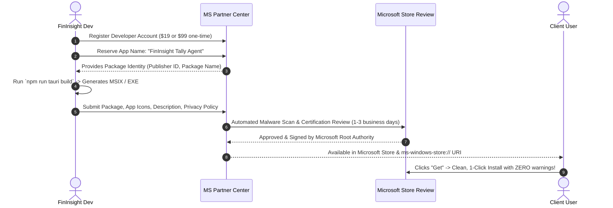

# Windows Code Signing, Digital Thumbprint & SmartScreen Warning Removal Guide

This document details how to eliminate the **"Windows protected your PC" (Microsoft Defender SmartScreen)** and **"Unknown Publisher / Malicious"** warnings for the FinInsight Tally Agent desktop application (`fininsight-tally-agent.exe`).

It covers:
1. Root cause of the warning and how Windows SmartScreen evaluates trust.
2. What a digital certificate thumbprint is and how it is used.
3. **Option A: Web Download Distribution** (Direct EXE/Setup from website) — OV vs. EV vs. Azure Trusted Signing.
4. **Option B: Microsoft Store Distribution** (MSIX / Win32 Store App) — Flow and certification.
5. Comparison matrix and recommended roadmap for FinInsight.

---

## 1. Why Does Windows Show the "Malicious / Unknown Publisher" Warning?

When a user downloads and runs an executable on Windows 10/11, Windows Defender SmartScreen analyzes the binary:

```
┌─────────────────────────────────────────────────────────────┐
│  Windows protected your PC                                  │
│  Microsoft Defender SmartScreen prevented an unrecognized   │
│  app from starting. Running this app might put your PC      │
│  at risk.                                                   │
│                                                             │
│  App:       fininsight-tally-agent.exe                      │
│  Publisher: Unknown publisher                               │
│                                                             │
│                 [ Don't run ]           [ More info -> Run anyway ]
└─────────────────────────────────────────────────────────────┘
```

SmartScreen triggers this warning due to two factors:
1. **Missing or Untrusted Digital Signature**: The `.exe` has no cryptographic signature, or uses a self-signed certificate that Windows does not recognize.
2. **Lack of SmartScreen Reputation**: SmartScreen maintains a cloud reputation score for binary hashes and certificate identities. A brand new binary or an unsigned binary has zero reputation.

To remove this warning, you must establish **Authenticode Digital Signing** using a recognized certificate authority (CA) or distribute through **Microsoft Store**.

---

## 2. What is a Digital Certificate Thumbprint?

A **Thumbprint** (also called certificate hash or SHA-1/SHA-256 fingerprint) is a 40-character hexadecimal string that uniquely identifies an installed digital certificate on Windows.

### Example Thumbprint
```
a1b2c3d4e5f67890123456789abcdef012345678
```

### How Windows Uses It
When you sign a binary using Windows `signtool.exe` or Tauri's bundle configuration, you do not pass certificate passwords in plaintext. Instead, the certificate is installed into the Windows Certificate Store (`Cert:\CurrentUser\My` or `Cert:\LocalMachine\My`), and `signtool` looks up the private key using the **Thumbprint**:

```powershell
signtool.exe sign /sha1 "a1b2c3d4e5f67890123456789abcdef012345678" /tr http://timestamp.digicert.com /td sha256 /fd sha256 "fininsight-tally-agent.exe"
```

### Essential Rule: RFC 3161 Timestamping (`/tr` and `/td sha256`)
Always sign with a timestamp server (`http://timestamp.digicert.com`). Without a timestamp, when your certificate expires (usually after 1–3 years), Windows will immediately invalidate your previously distributed application binaries. With a valid timestamp, binaries signed before the expiration date **remain trusted indefinitely**.

---

## 3. Option A: Web Download Distribution (Direct EXE from Website)

In this model, users download `fininsight-tally-agent.exe` (or an NSIS setup installer) directly from your web portal (e.g., `https://fin.turtleiqlabs.com/download`).

### 3.1 Types of Code Signing Certificates

Since **June 1, 2023**, the CA/Browser Forum mandated that **all private keys for code signing certificates must be stored on FIPS 140-2 Level 2 compliant hardware** (e.g., physical USB YubiKey token or Cloud HSM). Traditional `.pfx` software files stored on disk are no longer issued by commercial CAs.

| Certificate Type | Cost (approx.) | Vetting Process | SmartScreen Warning Status | Hardware Requirement |
|---|---|---|---|---|
| **Standard OV (Organization Validation)** | $200 – $350 / year | Business registration, phone verification (2–3 days) | ⚠️ **Warning remains initially**. Clears only after ~100–300 clean downloads across different Windows PCs. | Physical USB Token or Cloud HSM |
| **EV (Extended Validation)** | $450 – $650 / year | In-depth legal & operational verification (3–5 days) | ✅ **Zero warning immediately from download #1**. Instant SmartScreen trust. | Physical USB Token or Cloud HSM |
| **Azure Trusted Signing** *(Recommended for Web)* | ~$9.99 / month | Microsoft Identity verification via Azure subscription | ✅ **Immediate SmartScreen trust**. Fully cloud-managed. | None (Cloud HSM managed by Microsoft) |

---

### 3.2 Sub-Option: Microsoft Azure Trusted Signing (Modern Best Practice)

Microsoft recently launched **Azure Trusted Signing** (formerly *Azure Code Signing*). It is now the most practical, cost-effective, and secure method for signing Windows desktop apps:

- **Cost**: ~$9.99/month (vs. $500+/year for traditional EV tokens).
- **No Physical Hardware Tokens**: No shipping delays for USB keys; keys live in Microsoft's secure Cloud HSM.
- **Instant CI/CD Integration**: Works seamlessly with GitHub Actions, Azure DevOps, and local PowerShell.
- **SmartScreen Trust**: Uses Microsoft's trusted root CA, giving rapid reputation build and verified publisher identity.

#### How to Set Up Azure Trusted Signing:
1. In the Azure Portal, create a **Trusted Signing Account** (in supported regions like East US / West Europe).
2. Complete Organization Identity Validation (requires company legal documents).
3. Create a **Certificate Profile** (Public Trust).
4. Install the Azure Trusted Signing dlib for `signtool.exe` or use the GitHub Action `azure/trusted-signing-action`.

---

### 3.3 Signing Configuration in Tauri 2

Tauri 2 has native support for signing Windows NSIS installers and executables.

In `tally-agent/src-tauri/tauri.conf.json`:
```json
{
  "bundle": {
    "active": true,
    "targets": ["nsis"],
    "windows": {
      "digestAlgorithm": "sha256",
      "timestampUrl": "http://timestamp.digicert.com",
      "tsp": true,
      "certificateThumbprint": "YOUR_CERTIFICATE_THUMBPRINT_HEX"
    }
  }
}
```

Or automate it in `tally-agent/scripts/build-exe.js`:
```javascript
// Post-build signing step in build-exe.js
import { execSync } from "child_process";

const thumbprint = process.env.CERT_THUMBPRINT;
if (thumbprint) {
  console.log(`\n🔏 Signing binary with thumbprint ${thumbprint}...`);
  execSync(
    `signtool sign /sha1 "${thumbprint}" /tr http://timestamp.digicert.com /td sha256 /fd sha256 "${destPath}"`,
    { stdio: "inherit" }
  );
  console.log("✅ Binary digitally signed successfully.");
}
```

---

### 3.4 Internal / Pilot Testing Option: Self-Signed Root Certificate (Zero Cost)

If you are deploying within an enterprise team or for internal testing before purchasing a commercial certificate:
1. Generate a self-signed Code Signing Certificate on Windows:
   ```powershell
   $cert = New-SelfSignedCertificate -Type CodeSigningCert -Subject "CN=FinInsight Technologies" -CertStoreLocation "Cert:\CurrentUser\My"
   $thumbprint = $cert.Thumbprint
   Write-Host "Thumbprint: $thumbprint"
   ```
2. Sign the `.exe` using this thumbprint:
   ```powershell
   signtool sign /sha1 $thumbprint /fd sha256 "tally-agent\release-exe\fininsight-tally-agent.exe"
   ```
3. Export the public certificate (`.cer`) and install it into **"Trusted Root Certification Authorities"** on the target client machine.
   - Result: That machine will show **"Publisher: FinInsight Technologies"** in blue, with **zero SmartScreen warnings**.

---

## 4. Option B: Microsoft Store Distribution (MSIX / Store Submission)

In this model, the application is distributed through the **Microsoft Store** (or a direct link opening the Microsoft Store app on Windows 10/11).

```
┌────────────────────────────────────────────────────────┐
│  FinInsight Tally Agent                                │
│  Turtle IQ Labs · Utilities & Tools                    │
│                                                        │
│  [  Get / Install in Microsoft Store  ]                │
│                                                        │
│  ✓ Verified by Microsoft                               │
│  ✓ Automatic Background Updates                        │
└────────────────────────────────────────────────────────┘
```

### 4.1 Why Microsoft Store Removes All SmartScreen Warnings
When an application is distributed through the Microsoft Store:
- **Microsoft automatically signs the package** with Microsoft's own trusted Store root certificate.
- **Zero SmartScreen Warnings**: All Windows machines inherently trust any application installed through the Microsoft Store from day one.
- **No Third-Party EV Certificate Needed**: You do NOT need to buy a $500/year DigiCert or Sectigo certificate.
- **Automatic Silent Updates**: When you publish a new version on the Store, Windows automatically updates the agent in the background for all users.

---

### 4.2 Requirements & Cost
1. **Microsoft Partner Center Developer Account**:
   - Individual Account: **$19 one-time fee** (no annual fee).
   - Company Account: **$99 one-time fee** (requires company legal documents / D-U-N-S number).
2. **Revenue Share**: 0% for non-gaming apps that use their own payment processor (FinInsight backend). Microsoft takes no cut on SaaS integrations.

---

### 4.3 Two Ways to Submit Tauri 2 Apps to the Microsoft Store

#### Method 1: Packaged MSIX (Recommended for Desktop Agents)
Tauri supports packaging as an MSIX bundle:
1. In `tauri.conf.json`, add `"msix"` to bundle targets or generate using Microsoft `MakeAppx.exe`.
2. Configure package identity:
   ```json
   "bundle": {
     "targets": ["nsis", "msix"],
     "windows": {
       "nsis": { ... },
       "msix": {
         "publisher": "CN=YourPartnerCenterPublisherID",
         "identityName": "FinInsight.TallyAgent"
       }
     }
   }
   ```
3. Upload the `.msix` / `.msixupload` package to Microsoft Partner Center.

#### Method 2: Win32 Store Publishing (Unpackaged EXE)
Microsoft Store now allows submitting standard Win32 `.exe` applications directly:
1. You provide the direct download URL of `fininsight-tally-agent.exe` hosted on your HTTPS server (e.g., AWS S3 / Cloudflare R2).
2. Microsoft's Store catalog lists your app, handles installation, and validates safety.
3. *Note*: In this method, the `.exe` must still have a valid code signing certificate (OV or Azure Trusted Signing) so Microsoft's automated scanner can verify publisher identity.

---

### 4.4 End-to-End Submission Flow for Microsoft Store



---

## 5. Comprehensive Comparison Matrix

| Criteria | Option A1: Commercial EV Certificate (Web) | Option A2: Azure Trusted Signing (Web) | Option B: Microsoft Store (MSIX / Store) |
|---|---|---|---|
| **Cost** | High ($450 – $650 / year) | Low (~$9.99 / month) | Minimal ($19 or $99 **one-time**) |
| **SmartScreen Warning** | ✅ Removed instantly | ✅ Removed instantly | ✅ Removed instantly |
| **Hardware Token** | Required (USB YubiKey) | None (Cloud-managed) | None |
| **Setup Time** | 3–5 days (phone & legal vetting) | 2–4 days (Azure verification) | 2–5 days (Partner Center verification) |
| **User Download Experience** | Browser download `.exe` -> User runs file | Browser download `.exe` -> User runs file | 1-Click install from Microsoft Store or web badge |
| **Silent Auto-Updates** | Must implement custom updater logic | Must implement custom updater logic | Built-in automatic background updates via Windows |
| **Enterprise / Firewall** | Works behind strict proxies | Works behind strict proxies | Requires Microsoft Store access (sometimes blocked on locked corporate IT PCs) |
| **Tally Localhost Port 9000** | Full loopback network access | Full loopback network access | Full loopback network access (requires `runFullTrust` capability in MSIX) |

---

## 6. Recommended Action Plan for FinInsight

For a commercial enterprise product bridging local Tally accounting data with FinInsight Cloud, we recommend a **hybrid two-phase strategy**:

### Phase 1: Web Download via Azure Trusted Signing (Fastest & Most Flexible)
1. **Enroll in Azure Trusted Signing**:
   - In your existing Microsoft/Azure organization, create a Trusted Signing account.
   - Monthly cost is only ~$9.99/mo with zero physical token management.
2. **Retrieve Certificate Thumbprint**:
   - Link the certificate profile and extract the SHA-256 thumbprint.
3. **Automate in `build-exe.js`**:
   - Add signing into `tally-agent/scripts/build-exe.js` so every production build is signed automatically.
4. **Outcome**:
   - Clients downloading `fininsight-tally-agent.exe` from your dashboard get **zero SmartScreen warnings** and a verified publisher identity.

### Phase 2: Microsoft Store Listing (Maximum Trust & Discovery)
1. Register **Microsoft Partner Center** ($99 company account).
2. Configure Tauri 2 to output both `nsis` (for direct enterprise web installer) and `msix` (for Store submission).
3. Publish to Microsoft Store with deep link:
   - On the web dashboard, provide a button: *"Install via Microsoft Store"* (`ms-windows-store://pdp/?productid=...`).
4. **Outcome**:
   - Clients who prefer app-store convenience get frictionless 1-click installation and automatic silent updates without having to download `.exe` files manually.
